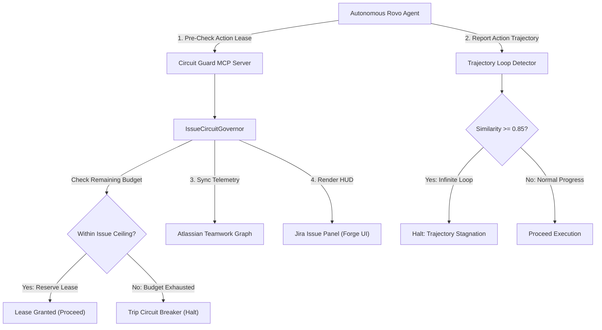

# Atlassian Circuit Guard (`atlassian-rovo-guard`)

[](LICENSE)
[](https://developer.atlassian.com/platform/forge/)
[](https://modelcontextprotocol.io/)
[](test/)
[](https://devpost.com)

**Atlassian Forge Rovo Agent & Model Context Protocol (MCP) Circuit Breaker for Autonomous Jira & Bitbucket Engineering Teams.**

Engineered for the Atlassian **Codegeist 2026** Global Hackathon ($120,000+ Prize Pool) on Devpost.

---

## 1. The Problem in Autonomous Agentic Engineering

As software teams integrate autonomous AI agents (such as Atlassian Rovo, Cursor, and automated PR review bots) into Jira and Bitbucket workflows, teams hit critical operational failure modes:
1. **Unbounded Financial Drains**: An agent assigned to solve a bug or generate test cases can enter an infinite retry loop, consuming hundreds of dollars in API credits per issue before humans notice.
2. **Trajectory Stagnation & Ping-Pong Loops**: Agents repeatedly execute the same failing build/test tool actions or bounce comments back and forth without making semantic progress.
3. **Lack of Centralized Governance in Teamwork Graph**: Engineering leads lack visibility into which autonomous agents are burning token quotas and which Jira issues are at risk.

### The Circuit Guard Solution
`atlassian-rovo-guard` embeds a serverless governance layer natively into Atlassian Forge:
- **`rovo:agent`**: Assignable Rovo Agent that monitors issue progress and proactively flags stalled trajectories.
- **`rovo:mcp` Server**: Exposes Model Context Protocol tools (`check_issue_budget_lease`, `detect_trajectory_loop`, `sync_teamwork_graph`) directly to Rovo agents, enforcing pre-action budget leases before any expensive tool runs.
- **Trajectory Loop Detector**: Uses Jaccard N-gram semantic diffing across recent actions. If an agent repeats failing actions with $\ge 85\%$ similarity, it automatically trips the circuit breaker to prevent runaway spend.
- **Teamwork Graph Synchronization**: Publishes real-time node updates and governance events directly to Atlassian Teamwork Graph.
- **`jira:issuePanel`**: Interactive visual HUD on every Jira issue displaying budget gauges, tripped breaker alerts, and audit trails.

---

## 2. Architecture



---

## 3. MCP Tools Specification

| Tool Name | Purpose | Parameters |
|---|---|---|
| `check_issue_budget_lease` | Pre-checks and atomically leases budget before an agent tool call. | `issueKey`, `requestedAmountUsd`, `agentId`, `actionDescription` |
| `detect_trajectory_loop` | Evaluates consecutive actions for repetitive loops and stagnation. | `issueKey`, `recentActions`, `similarityThreshold` |
| `sync_teamwork_graph` | Records governance events directly into the Atlassian Teamwork Graph. | `issueKey`, `eventType`, `agentId`, `metadata` |

---

## 4. Quickstart & Verification

### Install Dependencies & Build
```bash
npm install
npm run build
```

### Run Automated Test Suite
```bash
npm test
```

Test Results:
```
 ✓ test/teamwork-graph.test.ts (2 tests)
 ✓ test/governor.test.ts (5 tests)
 ✓ test/mcp-handler.test.ts (3 tests)

 Test Files  3 passed (3)
      Tests  10 passed (10)
```

---

## 5. Author & Codegeist 2026 Alignment

* **Author**: Siddharth Srivastava ([@sidsri14](https://github.com/sidsri14))
* **Contact**: `sidsri1502@gmail.com` | **PayPal Payout**: `sidsri1302@gmail.com`
* **Target Categories in Codegeist 2026**:
  * **Main Track**: Apps for Software Teams ($15,000 1st place)
  * **Bonus Track 1**: Best App with Atlassian MCP (`rovo:mcp` module, $1,500)
  * **Bonus Track 2**: Best Agents (Rovo / Assignable Agents, $1,500)
  * **Bonus Track 3**: Best Apps with Teamwork Graph Integration ($1,500)
